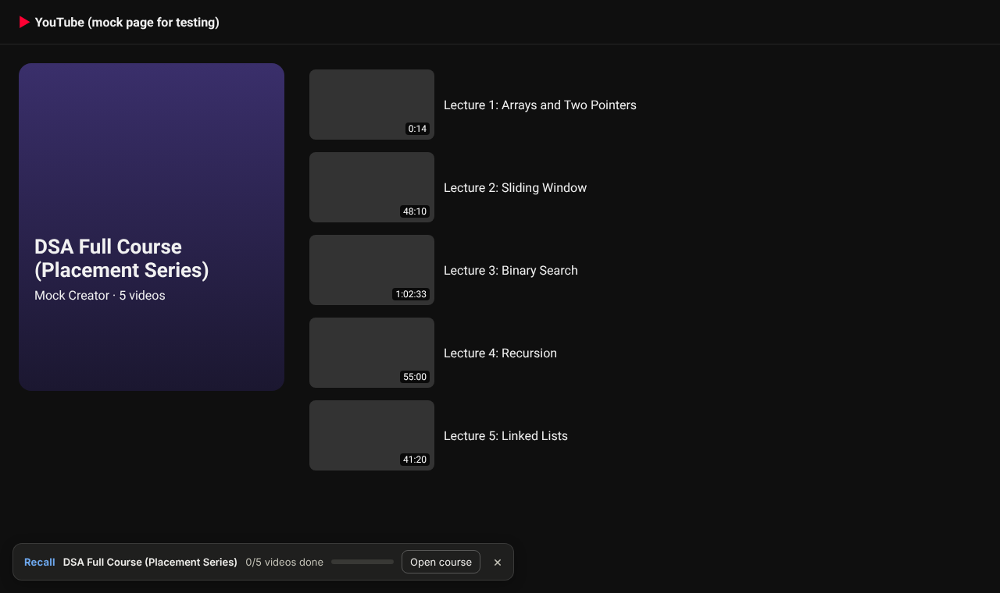
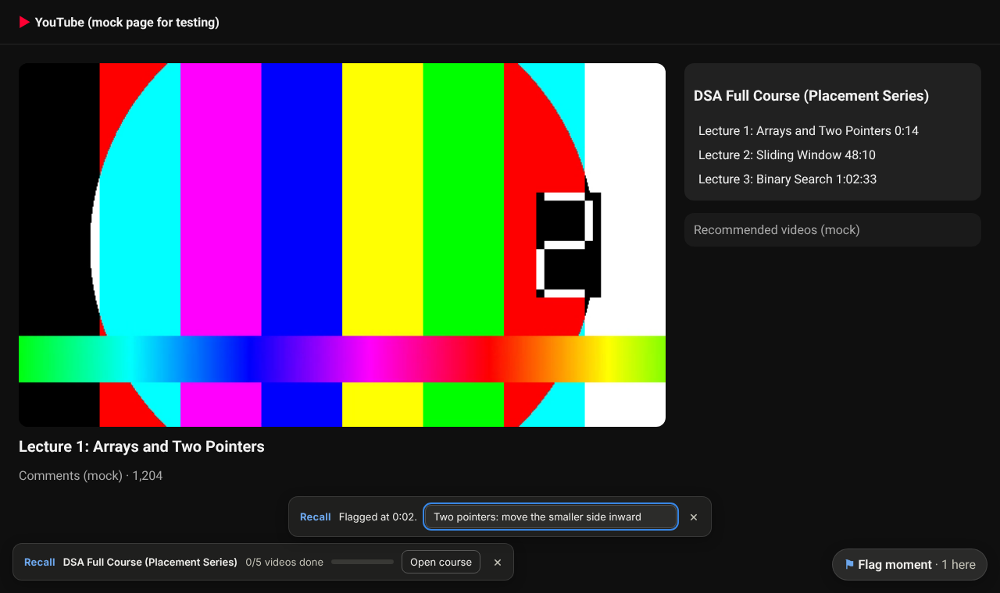
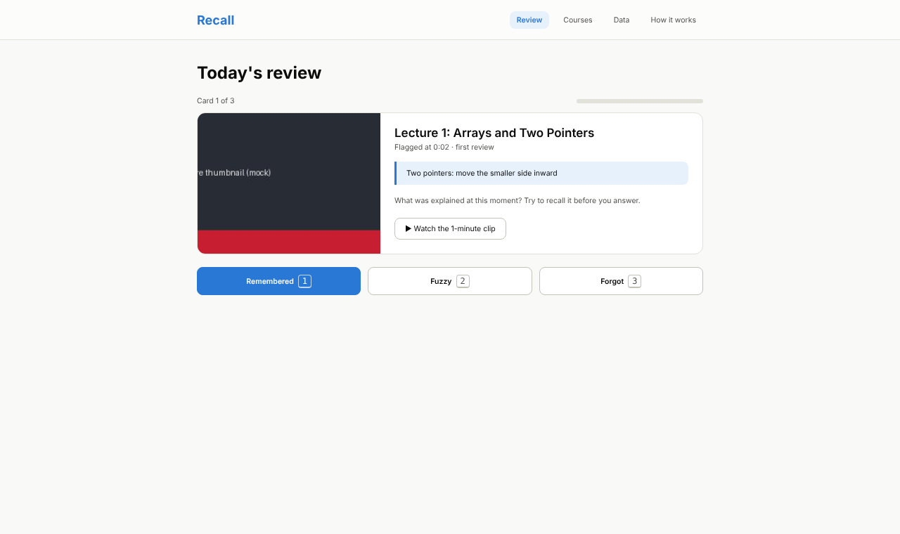

# Recall: remember what you watch on YouTube

A Chrome extension for students who learn from YouTube playlists (DSA, CS fundamentals, placement prep). It turns a playlist into a tracked course, lets you flag key moments with one key, and turns those flags into a 10-minute daily review spaced by how well you remembered.

This is the MVP from the Recall strategy doc. It pairs with the **Recall PM dashboard** (Streamlit), which reads this extension's exported events.

| Track a playlist | Flag a moment | Daily review |
| --- | --- | --- |
|  |  |  |

*Screenshots are from the automated test, which runs on mock YouTube pages.*

## What it does

1. **Playlist → course.** On any YouTube playlist (or a video playing from one), click **Track this playlist as a course** at the bottom left. Recall reads the videos, their order and durations. A video counts as done at 90% watched.
2. **One-key flags.** While watching, press **Alt+Shift+F** (change it at `chrome://extensions/shortcuts`) or click **⚑ Flag moment**. Add an optional one-line note without pausing.
3. **Spaced review.** The toolbar badge shows how many cards are due. Rate each card **Remembered / Fuzzy / Forgot**. Remembered cards come back after 1 → 3 → 7 → 14 → 30 days; fuzzy ones tomorrow; forgotten ones reset to tomorrow, with a one-minute clip around the flag. The cap is 10 cards a day.
4. **Cram mode.** Every flag in a course, weakest first, for the week before an interview. It doesn't change the schedule.
5. **Focus mode.** Hides recommendations, Shorts, comments and the home feed, but keeps the playlist panel.
6. **Pilot export.** **Data → Download events.csv** exports anonymous usage events in exactly the schema the dashboard reads.

Not built yet (should-haves in the strategy doc): AI recall questions (run as an A/B test against plain cards), and streaks counted on review days only.

## Try it (no coding setup needed)

1. Download this folder: on GitHub, **Code → Download ZIP**, then unzip it.
2. In Chrome, open `chrome://extensions` and turn on **Developer mode** (top right).
3. Click **Load unpacked** and pick the unzipped folder (the one containing `manifest.json`).
4. Pin Recall from the puzzle-piece menu. The welcome page opens on its own.
5. Open a YouTube playlist and click **Track this playlist as a course**.

After editing any file, click the ↻ reload icon on Recall's card in `chrome://extensions`, then refresh YouTube tabs.

## Running the pilot

1. Give 10–20 students the ZIP and the four steps above, or publish it on the Chrome Web Store (below).
2. Once a week, each student opens **Recall → Data → Download events.csv** and uploads it to a Google Form with a file-upload question (responses land in your Drive).
3. Upload all the files to the dashboard at once; it merges them and removes duplicate events.
4. **Uninstalls:** the extension can't report its own uninstall without a server. For free tracking, make a Google Form with a short-answer "user_id" question, take its pre-filled link, and paste it into `UNINSTALL_FORM_URL` in `lib/config.js` with the answer replaced by `{USER_ID}`. Add those rows to your events file as `uninstall` events.

## Publishing on the Chrome Web Store

- Register a developer account (one-time fee) at the Chrome Web Store Developer Dashboard.
- Zip the folder **without** the `tests/` and `docs/` folders, and upload it.
- Use `PRIVACY.md` as the privacy policy (host it as a public page, e.g. GitHub Pages or a public Google Doc).
- Permission justifications: `storage` (saves your courses and flags locally), `alarms` (refreshes the due-cards badge), `youtube.com` host access (reads playlists and the video player).
- Google reviews new extensions; allow a few days.

## Project structure

| Path | What it does |
| --- | --- |
| `manifest.json` | Manifest V3: permissions, content script, Alt+Shift+F command |
| `background.js` | Service worker. The only code that writes storage; queues every change so tabs can't overwrite each other |
| `lib/state.js` | All state changes as plain functions (tested in Node) |
| `lib/srs.js` | Leitner scheduling, due-card selection, cram order |
| `lib/csv.js` | Export in the dashboard's schema |
| `lib/config.js` | Daily cap, review intervals, clip length, uninstall form |
| `content/` | Runs on youtube.com: playlist detection, course bar, progress, flag button, note toast, clip playback, focus mode |
| `popup/` | Toolbar popup: today's review, courses, focus toggle |
| `app/` | Full page: Review, Cram, Courses, Data, How it works |
| `tests/logic.test.mjs` | Scheduling, export and a simulated student journey: `node --test tests/logic.test.mjs` |
| `tests/e2e/run_e2e.py` | Loads the real extension in Chrome and runs 21 checks on mock YouTube pages (see the file header) |

## Events logged (for the dashboard)

`install`, `course_added`, `study_session` (watch seconds on a tracked course; sessions under 30 s are ignored), `video_completed`, `flag_created`, `card_reviewed` (rating + review number), `review_session_completed` (seconds), `detection_error`. Timestamps are UTC ISO 8601; the dashboard converts them to India time to count days.

## Known limitations

- **YouTube changes its page often.** Playlists are read from the video links themselves rather than YouTube's internal layout, which is the most stable signal available, but a YouTube redesign can still break detection. The `detection_error` event and the dashboard's reliability guardrail exist to catch this.
- **Long playlists load as you scroll.** Recall adds videos as YouTube loads them, so scroll a long playlist once after tracking it.
- **Progress is "furthest point reached".** Skipping to the end counts as watching it.
- **Desktop Chrome only.** Mobile Chrome doesn't run extensions. This was a deliberate trade-off in the strategy doc (laptop-first segment).
- **Data lives in the browser.** Clearing browser data or switching computers starts fresh; the weekly export is the backup.
